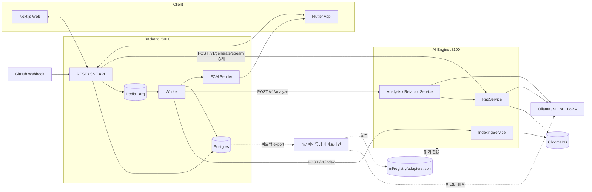
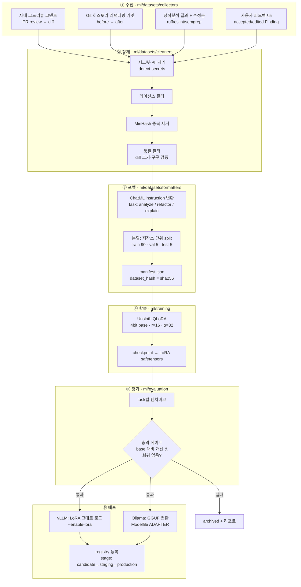
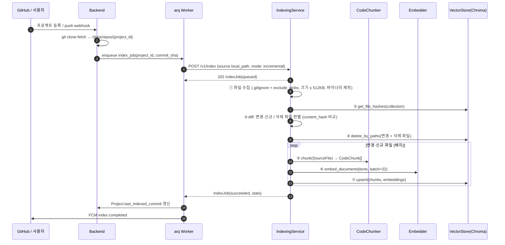
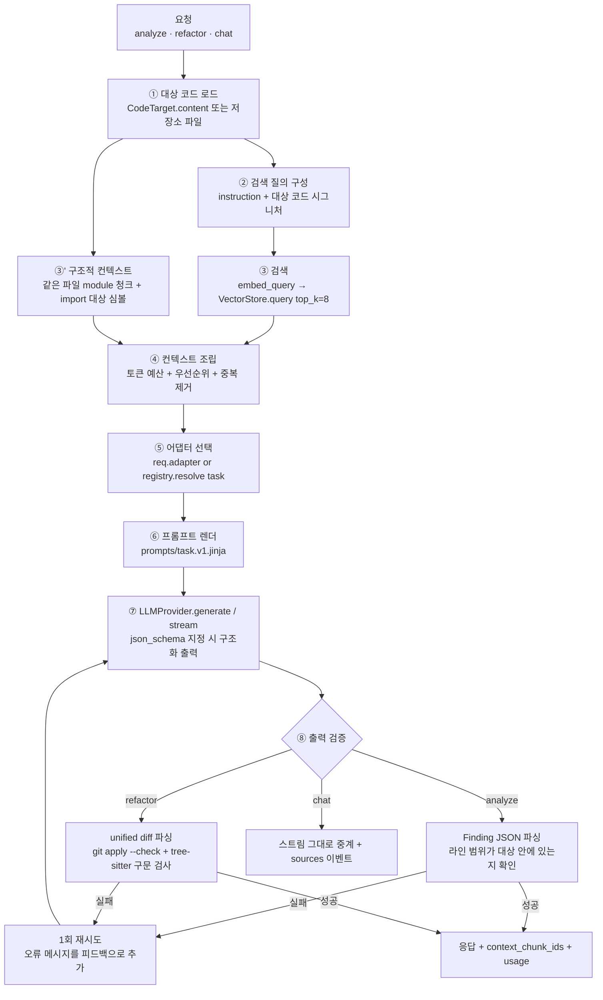
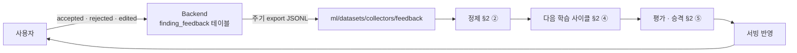

# 02. AI 파인튜닝 및 RAG 파이프라인 데이터 흐름

- 상태: **승인됨** (2026-10-21, Q1~Q6 확정)
- 작성: Claude · 2026-10-21
- 관련: [ADR-0001](../adr/0001-monorepo-and-service-split.md), [engine.v1.yaml](../../contracts/openapi/engine.v1.yaml)

이 문서는 데이터 흐름 네 가지를 정의한다. 섹션 번호(§)는 서비스 모듈 docstring과 작업 카드에서 참조한다.

| § | 흐름 | 실행 위치 | 주기 |
|---|---|---|---|
| §1 | 전체 시스템 흐름 | 전체 | — |
| §2 | 파인튜닝 파이프라인 (Offline) | `ml/` (GPU 머신) | 수동 / 주기 배치 |
| §3 | 코드베이스 색인 (RAG Ingestion) | `ai-engine` `IndexingService` | 프로젝트 등록·push 시 |
| §4 | 분석·리팩터링·대화 (RAG Query + Generation) | `ai-engine` `Rag/Analysis/RefactorService` | 사용자 요청 시 |
| §5 | 피드백 루프 (Data Flywheel) | `backend` → `ml/` | 지속 |

---

## §1. 전체 시스템 흐름



**동기와 비동기 구분**
- **동기(SSE):** 채팅. 사용자가 응답 지연을 바로 체감하므로 Backend가 Engine 스트림을 그대로 중계한다.
- **비동기(잡 큐):** 색인과 파일 단위 분석. 수십 초에서 수 분이 걸리므로 `202 Accepted`를 즉시 반환하고, 완료되면 FCM 푸시와 웹 폴링으로 알린다.

---

## §2. 파인튜닝 파이프라인 (Offline)



### 2.1 학습 샘플 포맷 (ChatML, JSONL 1줄 = 1샘플)

```json
{
  "task": "refactor",
  "messages": [
    {"role": "system", "content": "<prompts/refactor.v1 system 템플릿과 동일>"},
    {"role": "user", "content": "<instruction>\n<context: 관련 청크>\n<target code>"},
    {"role": "assistant", "content": "<unified diff + 설명 | Finding JSON>"}
  ],
  "meta": {"repo": "…", "commit": "…", "lang": "python", "source": "git_history"}
}
```

**핵심 원칙: Train/Serve Prompt Parity.** 학습 샘플의 system/user 구조는 서빙 시 `engine/prompts/*.jinja`가 렌더하는 구조와 **같은 템플릿**으로 만든다. 학습 때 RAG 컨텍스트 블록을 넣은 형태로 학습해야 서빙할 때 RAG 컨텍스트를 제대로 활용한다. `formatters/`는 `engine/prompts/`의 템플릿 파일을 읽어서 쓴다 (코드 import가 아니라 파일 공유).

### 2.2 데이터 누수 방지
- **저장소 단위로 split**한다. 같은 저장소의 파일이 train과 test에 나뉘어 들어가지 않게 한다.
- 평가 세트는 고정하고 `ml/evaluation/benchmarks/`에 버전을 관리한다. 학습 데이터 수집 대상에서 제외한다.

### 2.3 평가 지표와 승격 게이트

| task | 지표 | 게이트 (초안) |
|---|---|---|
| refactor | patch apply 성공률, 구문 유효율, 적용 후 테스트 통과율 | apply ≥ 90%, base 대비 테스트 통과율 +5%p |
| analyze | Finding precision / recall (라벨 세트 기준), JSON 스키마 준수율 | 스키마 준수 ≥ 98%, F1 base 대비 개선 |
| 공통 | 일반 코딩 벤치마크 회귀 (HumanEval류 소규모) | base 대비 하락 ≤ 2%p |

### 2.4 Registry 엔트리 (`ml/registry/adapters.json`)
`engine.core.models.AdapterInfo`와 1:1로 대응한다. 쓰기는 `ml/evaluation/run_eval.py`만 하고, Engine은 `LoRAAdapterRegistry`를 통해 읽기만 한다. `resolve(task)`가 `production` 어댑터를 선택하며, 해당 어댑터가 없으면 base 모델로 폴백한다.

---

## §3. 코드베이스 색인 (RAG Ingestion)



### 3.1 청킹 규칙 (`CodeChunker`)

| 단위 | 내용 | 비고 |
|---|---|---|
| `function` / `method` | 시그니처 + docstring + 본문 | 기본 단위 |
| `class` | 클래스 선언 + 필드 + **메서드 시그니처만** | 메서드 본문은 별도 청크 |
| `module` | import, 상수, 최상위 코드 | 파일당 1개 |
| `window` | 120줄 윈도우, 20줄 overlap | 미지원 언어, 파싱 실패, 200줄 초과 심볼 |

**임베딩 입력 텍스트**에는 검색 품질을 위해 헤더를 붙인다.
```
# path: src/app/services/user.py
# symbol: UserService.create (method, python)
<code>
```

### 3.2 청크 ID와 메타데이터
- `chunk_id = "{project_id}:{path}::{symbol}@{start_line}-{end_line}"` ([ADR-0004](../adr/0004-chunk-text-split-and-id.md)). 같은 파일의 동명 심볼도 충돌하지 않는다. 줄 위치가 바뀌면 ID가 바뀌므로 변경된 파일은 항상 path 단위로 전부 삭제한 뒤 재삽입한다(§3.3).
- 청크는 `raw_code`(원본 그대로, 인용·표시용)와 `search_text`(헤더 + 렌더링 코드, 임베딩 입력)를 따로 가진다.
- Chroma 메타데이터: `path`, `language`, `kind`, `symbol`, `start_line`, `end_line`, `content_hash`, `commit_sha`.
- 컬렉션: `proj_{project_id}` (프로젝트 간 격리, 삭제 시 `drop_collection`).

### 3.3 증분 색인 정책
- 파일 단위로 처리한다. 변경된 파일은 기존 청크를 **전부 삭제한 뒤 재삽입**한다. 심볼 단위 diff보다 단순하고, 삭제된 심볼이 남는 문제가 없다.
- 임베딩 모델이 바뀌면 컬렉션의 dimension이 달라지므로 `ensure_collection`에서 오류가 난다. 이때는 `mode: full`로 재색인한다.

---

## §4. 분석 · 리팩터링 · 대화 (RAG Query + Generation)



### 4.1 컨텍스트 조립 규칙 (`RagService`)

모델 컨텍스트 예산. **v2(ADR-0003, RTX 5070 Ti 16GB)부터 기본은 슬롯당 16K(`ENGINE_NUM_CTX=16384`)이므로 아래 표의 "16K" 열이 기본 예산이다.** 8K 열은 v1(RTX 4060 8GB, `ENGINE_NUM_CTX=8192`) 기준 이력이다:

| 우선순위 | 블록 | 기본 (8K) | 긴 컨텍스트 모드 (16K, hybrid) |
|---|---|---|---|
| 1 | system 프롬프트 + 출력 스키마 | ~0.8K | ~0.8K |
| 2 | **대상 코드** (잘라내지 않음, 초과 시 `context_too_large`) | ≤ 3K | ≤ 7K |
| 3 | 구조적 컨텍스트 (같은 파일 module 청크, import 대상 심볼) | ≤ 1.5K | ≤ 3K |
| 4 | 유사 청크 (score 내림차순, 대상과 겹치는 청크 제외) | 나머지 (~1.2K, 2~4개) | 나머지 |
| — | 생성용 예약 (`max_tokens`) | 1.5K | 3K |

- 긴 컨텍스트 모드는 대상 코드가 3K를 넘는 **refactor 요청에만** 자동으로 적용한다. 일부 레이어가 CPU로 오프로드되어 느려질 수 있다.
- 학습 샘플(seq 2K~4K)은 같은 템플릿에서 블록 4를 0~2개로 줄여 생성한다 (ADR-0002 D-4).

- 토큰 수는 base 모델 토크나이저 기준으로 추정한다. MVP는 `len(text) / 3.5` 근사를 쓰고, 이후 실제 토크나이저로 교체한다.
- 동일 `path`의 청크가 인접하면 하나로 병합해 헤더 중복을 줄인다.

### 4.2 구조화 출력
- analyze 요청은 `GenerationRequest.json_schema`에 Finding 배열 스키마를 지정한다. Ollama는 `format` 필드, vLLM은 guided decoding을 쓴다.
- 구조화 출력을 쓰더라도 `StructuredOutputError` 검증은 항상 서비스 레이어에서 수행한다.

### 4.3 리팩터링 패치 검증
1. 모델 출력에서 diff 블록 추출 (`unidiff` 파싱)
2. 임시 worktree에서 `git apply --check`
3. 적용 결과 파일을 tree-sitter로 파싱해 ERROR 노드가 있는지 검사
4. 결과는 `PatchValidation`으로 반환한다. 검증에 실패해도 1회 재시도 후 **실패 상태 그대로 반환**한다 (사용자에게 투명하게 보여줌).

---

## §5. 피드백 루프 (Data Flywheel)



- `accepted`: (입력, 출력) 쌍을 positive 샘플로 쓴다.
- `edited`: 사용자가 수정한 `edited_suggestion`을 정답으로 쓴다. 가장 가치가 높은 샘플이다.
- `rejected`: SFT에서는 제외한다. 이후 DPO(선호 학습)용 negative로 보관한다.
- export할 때 analysis 레코드에 저장된 **프롬프트 버전 + context_chunk_ids**로 당시 입력을 재구성한다. Backend는 Engine 응답의 `context_chunk_ids`, `model`, `adapter`를 반드시 저장해야 한다.

---

## 데이터 저장소 요약

| 데이터 | 저장소 | 소유 서비스 | 보존 |
|---|---|---|---|
| 저장소 체크아웃 | 볼륨 `/data/repos/{project_id}` | Backend (쓰기), Engine (읽기 전용 마운트) | 프로젝트 삭제 시까지 |
| 코드 청크 벡터 | ChromaDB `proj_{id}` | Engine | 재색인 시 교체 |
| 프로젝트·분석·Finding·피드백 | Postgres | Backend | 영구 |
| 잡 큐 | Redis | Backend | 휘발 |
| 학습 데이터셋 | `ml/datasets/{raw,processed,splits}` (git 제외) | ml | 버전별 manifest |
| LoRA 가중치 | `ml/outputs/` → 서빙 엔진 볼륨 | ml | 레지스트리 기준 |
| 어댑터 메타 | `ml/registry/adapters.json` (git 관리) | ml (쓰기), Engine (읽기) | 영구 |

---

## 검토가 필요한 결정 사항

| # | 항목 | 제안 | 대안 |
|---|---|---|---|
| Q1 | Base 모델 | **[ADR-0003 v2](../adr/0003-base-model-and-lora-serving.md):** Qwen2.5-Coder-**7B**-Instruct Q4_K_M (RTX 5070 Ti 16GB; v1은 8GB 때문에 3B). 14B는 후보. LoRA는 `llama-server --lora`로 서빙 | 클라우드 학습 (24GB+) 후 7B |
| Q2 | 임베딩 모델 | **Ollama `nomic-embed-text`** (서빙 스택 단일화) | 코드 특화 임베딩 (bge-m3, jina-code 등) — 검색 품질 비교 후 교체 |
| Q3 | Engine의 코드 접근 방식 | **MVP: 공유 볼륨 읽기 전용 마운트** | 운영: Backend가 파일 내용을 전송 (GPU 노드 분리 시) |
| Q4 | 재순위화(Reranker) | **MVP 제외**, 검색 품질 지표 확인 후 도입 | cross-encoder reranker 추가 |
| Q5 | 학습 데이터 1차 소스 | **Git 히스토리 리팩터링 커밋 + 정적분석 수정본** (자동 수집 가능) | 사내 PR 리뷰 (품질↑, 수집 권한 필요) |
| Q6 | 어댑터 운영 단위 | **task별 어댑터** (analyze / refactor 분리) | 단일 멀티태스크 어댑터 (관리 단순, 간섭 위험) |
