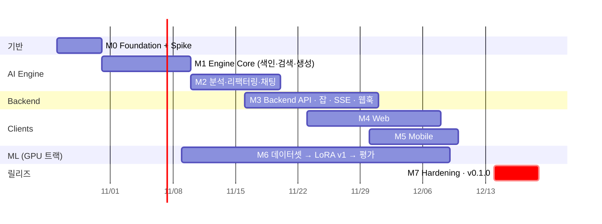

# 04. MVP 개발 · 릴리즈 로드맵 (v0.1.0)

- 상태: **초안 (검토 대기)**
- 작성: Claude · 2026-10-21
- 목표 릴리즈: **v0.1.0 — 2026-12-18 (W8 종료)**, 버퍼 W9 (12/21–12/24)

## 0. MVP 정의

> **한 명의 개발자가** 자기 저장소를 등록하면, **로컬 GPU 하나로** 코드가 색인되고,
> 웹에서 **파일 분석 → Finding 확인 → 리팩터링 패치 생성**과 **코드 대화**를 할 수 있으며,
> 작업이 끝나면 **모바일로 알림**을 받는다. 사용자의 피드백은 다음 LoRA 학습 데이터로 쌓인다.

### 범위

| 포함 (MVP) | 제외 (Post-MVP) |
|---|---|
| 단일 사용자 (정적 JWT) | 다중 사용자, RBAC, GitHub OAuth/App |
| Python, TypeScript 청킹 (나머지 언어는 window 폴백) | 언어별 심볼 그래프, 기타 언어 tree-sitter 튜닝 |
| Ollama 서빙 (base + GGUF LoRA) | vLLM 운영 배포, 멀티 GPU |
| task별 LoRA v1 (analyze, refactor), 미달 시 base 폴백 | DPO, 지속 학습 자동화 |
| GitHub push 웹훅 → 증분 색인 | PR 코멘트 봇, CI 연동 |
| Web: 대시보드, 분석, diff, 채팅 · App: 알림, 리포트 열람 | 앱 내 채팅, 패치 적용(커밋) 기능 |
| | Reranker (Q4 결정) |

---

## 1. 마일스톤과 일정

| 주차 | 기간 | Engine | Backend | Web / App | ML |
|---|---|---|---|---|---|
| W1 | 10/26–10/30 | **M0** 기반 + Spike | M0 | M0 스캐폴드 | M0 Spike |
| W2 | 11/02–11/06 | M1 어댑터 | — | — | — |
| W3 | 11/09–11/13 | M1 서비스·API | — | — | M6 수집기 |
| W4 | 11/16–11/20 | M2 분석 | M3 DB·프로젝트·잡 | — | M6 정제·포맷 |
| W5 | 11/23–11/27 | M2 리팩터·채팅 | M3 분석·리팩터 | M4 대시보드·프로젝트 | M6 학습 v1 |
| W6 | 11/30–12/04 | 버그 수정 | M3 SSE·웹훅·FCM | M4 분석·diff · **M5** FCM | M6 평가·게이트 |
| W7 | 12/07–12/11 | 성능 튜닝 | 통합 | M4 채팅 · M5 리포트 | M6 배포·피드백 export |
| W8 | 12/14–12/18 | **M7** | M7 | M7 | M7 |

GPU는 하나이므로 **서빙(개발 테스트)과 학습이 겹치지 않도록** M6 학습은 야간이나 주말 배치로 돌린다.

---

## 2. 마일스톤 상세

각 마일스톤의 작업은 Claude가 `docs/tasks/T-xxx.md` 카드로 쪼개고 Codex가 구현한다. 담당 표기: **C** = Claude, **X** = Codex.

### M0. Foundation + 기술 검증 Spike (W1)

| ID | 작업 | 담당 |
|---|---|---|
git 초기화는 착수 전(10/21)에 끝났다 (`806a236`). 카드: [docs/tasks/](../tasks/README.md)

| ID | 작업 | 담당 |
|---|---|---|
| T-001 | GitHub Actions: `make check` + `check-contracts` + 생성물 drift + 300줄 검사 | X |
| T-002 | `infra/docker/{backend,ai-engine}.Dockerfile` (uv 멀티스테이지) | X |
| T-003 | `py_common`: settings, structlog, request_id 미들웨어, Problem 예외 핸들러 (에러 카탈로그 생성) | C 설계 / X 구현 |
| T-004 | Web: `create-next-app` (TS strict) + openapi-fetch 클라이언트 + health 화면 | X |
| T-005 | Mobile: `flutter create` + api_client 연결 + 딥링크와 푸시 파싱 골격 | X |
| **S-01** | **Spike: 카나리아 LoRA → GGUF → Ollama `ADAPTER` 로드. 구조화 출력, 어댑터 전환 비용, 8GB VRAM 한계 측정 포함** | C + 사람 |
| S-02 | Spike: tree-sitter Python/TS 노드 매핑, 청킹 지표, T-014용 fixture | X |

**S-01이 가장 중요하다.** 개발 GPU가 RTX 4060 8GB이므로 ([ADR-0002](../adr/0002-gpu-budget-rtx4060-8gb.md)) S-01은 다음 세 가지를 W1 안에 결론 낸다. ① 7B QLoRA 학습이 peak < 7GB로 가능한가, ② 7B Q4 서빙이 8K full GPU로 예산 안에 들어오는가, ③ LoRA → GGUF → Ollama `ADAPTER` 경로가 동작하는가. 판정 결과(7B 또는 3B, Plan A/B/C)는 ADR-0003으로 확정한다.

**완료 기준:** CI 통과, `make up && make dev` 후 두 서비스의 `/v1/health`가 200, S-01 결과는 [ADR-0003](../adr/0003-base-model-and-lora-serving.md)(완료), S-02 결과는 리포트로 기록.

### M1. Engine Core — 색인 · 검색 · 생성 (W2–W3)

| ID | 작업 | 인터페이스 |
|---|---|---|
| [T-101](../tasks/T-101-fake-adapters.md) | `adapters/{llm,embeddings,vectorstore}/fake·in_memory` + 서비스 테스트 fixture | 전체 |
| [T-102](../tasks/T-102-llamaserver-provider.md) | `adapters/llm/llamacpp.py` (`LlamaServerProvider`: generate/stream/health, 어댑터 전환, 에러 변환) + `docker-compose` llama-server 서비스 ([ADR-0003](../adr/0003-base-model-and-lora-serving.md)) | `LLMProvider` |
| [T-103](../tasks/T-103-ollama-embedder-scheduling.md) | `adapters/embeddings/ollama_embed.py` (`nomic-embed-text`, 배치, L2 정규화, prefix) + **GPU/CPU 동적 스케줄링** (LLM 유휴 시 GPU, 생성 요청 시 CPU 폴백) | `Embedder` |
| [T-104](../tasks/T-104-chroma-vectorstore.md) | `adapters/vectorstore/chroma.py` (이름 변환·메타데이터 코덱·`$and` 필터, 진짜 서버로 스위트 재검증) | `VectorStore` |
| [T-105](../tasks/T-105-ast-chunker.md) | `adapters/parsing/treesitter_chunker.py` — Python, TypeScript/TSX/JS + window 폴백, `CodeChunk` raw_code/search_text 분리 ([ADR-0004](../adr/0004-chunk-text-split-and-id.md)) | `CodeChunker` |
| [T-106](../tasks/T-106-engine-registry.md) | `adapters/registry_file.py` + `container.py` 어댑터 조립·자원 소유권 + `main.py` lifespan | `LoRAAdapterRegistry` |
| [T-107](../tasks/T-107-indexing-service.md) | `services/indexing_service.py` (증분, 취소, 진행률) + **`VectorStore.replace_file`로 부분 실패 시 기존 검색 보존** + 파일 스캐너 ([ADR-0005](../adr/0005-failure-safe-file-replacement.md)) | `VectorStore`, `SourceScanner` |
| [T-108](../tasks/T-108-rag-service.md) | `services/rag_service.py` (결정적 검색 `(−score, chunk_id)`, §4.1 컨텍스트 조립, 근거 기반 채팅 스트림 Sources→Token→Done) | `VectorStore`, `Embedder`, `LLMProvider` |
| T-109 | `api/v1/{system,generate,index,retrieve}.py` + 실제 헬스 집계 + 계약 테스트 | — |
| **T-110** | **E2E CLI 스모크:** `python -m engine.cli smoke <repo>` — 컨테이너 조립 → 색인 → 질의 → 출처(경로·줄 범위) 포함 답변 → 검증. Fake(CI)와 실서버(수동) 두 모드 | 전체 |
| T-111 | 어댑터 하드닝 (Codex 감사 지적: Chroma 호출 타임아웃, 손상 레코드 예외 변환, LoRA 카탈로그 갱신) + **`infra/llama/entrypoint.sh`가 `/adapters/*.gguf`를 전부 로드해 base와 맞지 않는 어댑터(예: 3B용 canary)가 있으면 서버 기동이 실패하는 문제** — 레지스트리의 PRODUCTION·base_model 일치 어댑터만 로드 | `VectorStore`, `LLMProvider` |

> T-101~T-108 카드는 작성 완료 (T-101~T-106 구현 완료). T-109~T-111은 앞선 카드 구현 결과를 보고 순차 작성한다. **E2E 스모크(T-110)는 M1 완료 조건이다** — 어댑터 단위 테스트가 모두 green이어도 사용자 흐름 하나가 끝까지 돌지 않으면 M1을 닫지 않는다 (Codex 감사 2026-10-23).

**완료 기준**
- **E2E CLI 스모크(T-110)가 Fake 모드로 CI에서, 실서버 모드로 수동 실행에서 모두 통과.** 답변의 출처(경로·줄 범위)가 실제 `raw_code`와 일치
- 샘플 저장소(~10k LOC Python/TS)를 full 색인하는 데 5분 미만, 파일 1개 변경 시 증분 색인 10초 미만
- 손으로 라벨링한 질의 30개 기준 **recall@8 ≥ 0.6**. 미달이면 임베딩 모델 교체를 검토 (Q2 재검토 조건)
- `/v1/generate/stream`이 x-sse-policy를 준수 (keepalive, 연결 끊김 시 취소)

### M2. 분석 · 리팩터링 · 채팅 (W4–W5, base 모델)

| ID | 작업 |
|---|---|
| T-020 | `prompts/analyze.v1.jinja`, `refactor.v1.jinja`, `explain.v1.jinja` — **학습 포맷과 같은 구조** (C 작성) |
| T-021 | `services/analysis_service.py` — 구조화 출력, Finding 검증, 결정적 ID, 1회 재시도 |
| T-022 | `services/refactor_service.py` — diff 추출, 임시 worktree에서 `git apply --check`, tree-sitter 구문 검증 |
| T-023 | `api/v1/analyze.py`, `/v1/refactor`, `/v1/chat/stream` |
| T-024 | 평가 스크립트 초안 (`ml/evaluation/run_eval.py`) — M6 게이트와 같은 지표로 **base 기준선** 측정 |

**완료 기준 (base 모델 기준선):** 파일 50개 기준 Finding JSON 스키마 준수율 ≥ 95%, 패치 apply 성공률 ≥ 70%. 이 수치가 M6 LoRA의 비교 기준이 된다.

### M3. Backend (W4–W6)

| ID | 작업 |
|---|---|
| T-030 | SQLAlchemy 모델 + Alembic: project, job, analysis, finding, finding_feedback, refactor, chat_session, chat_message, device, idempotency_key |
| T-031 | `clients/engine/client.py` — §4 타임아웃·재시도 정책, §1.3 에러 매핑 |
| T-032 | 프로젝트 API + clone/fetch 워커 (`/data/repos`) + 최초 색인 잡 |
| T-033 | 잡 API + arq 워커 (index, analysis, refactor), 취소, 상태 머신 |
| T-034 | 분석, Finding(offset), 피드백, 리팩터 API |
| T-035 | 채팅 SSE 중계 + Redis Stream 버퍼 + `Last-Event-ID` 재개 (§2.4) |
| T-036 | GitHub 웹훅 (HMAC, 중복 제거, 필터 — events/README) |
| T-037 | 기기 등록 + FCM 발송 (push.v1, 토큰 정리, 재시도) |
| T-038 | Cursor 페이지네이션 공용 유틸 (keyset + 필터 해시), Idempotency 미들웨어 |

**완료 기준:** backend.v1.yaml의 모든 operation에 계약 테스트가 있음. 웹훅 push → 색인 → 푸시 E2E가 동작.

### M4. Web — Next.js (W5–W7)

| 화면 | 사용 API |
|---|---|
| 프로젝트 목록 / 등록 | `listProjects`(cursor 무한 스크롤), `createProject` |
| 프로젝트 상세 (색인 상태, 잡 타임라인) | `getProject`, `listJobs`, `reindexProject` |
| 분석 요청 / 결과 (심각도 필터, 페이지 번호) | `createAnalysis`, `getAnalysis`, `listFindings`(offset) |
| Finding 상세 + 피드백 + 리팩터 요청 + **diff 뷰어** | `submitFindingFeedback`, `refactorFinding`, `getRefactor` |
| 코드 채팅 (스트리밍, 출처 표시, 재연결) | `sendChatMessage`, `resumeChatStream` |

공용 작업으로는 생성 타입 기반 fetch 래퍼(Problem → `code`별 i18n 메시지), SSE 클라이언트 훅(`useChatStream`: 백오프 재연결, index 중복 제거), 잡 폴링 훅이 있다.

### M5. Mobile — Flutter (W6–W7)

| 기능 | 내용 |
|---|---|
| FCM | 토큰 등록/갱신, 포그라운드·백그라운드 처리, `event_id` 중복 제거 |
| 딥링크 | `codeai://projects/{pid}/(analyses|refactors|jobs)/{id}` 라우팅 |
| 잡 목록 | `listJobs` 커서 무한 스크롤, 상태 배지 |
| 분석 리포트 | `getAnalysis` + `listFindings` 읽기 전용, 심각도 요약 |

### M6. 파인튜닝 v1 (W3–W7, GPU 트랙)

| ID | 작업 |
|---|---|
| T-060 | 수집기: Git 히스토리 리팩터링 커밋 (메시지 키워드 + diff 크기 필터), ruff/semgrep 자동 수정 쌍 |
| T-061 | 정제: detect-secrets, 라이선스 필터, MinHash 중복 제거, 구문 검증 |
| T-062 | 포맷터: `engine/prompts/*.jinja` 렌더로 ChatML 생성 (prompt parity), 저장소 단위 split, manifest |
| T-063 | `train_lora.py`: Unsloth QLoRA, `ml/training/configs/*-qlora-8gb.yaml` 사용, **VRAM 가드 (peak reserved ≥ 6.5GB 또는 시스템 ≥ 7.6GB면 중단)**, Ollama 중지 확인 |
| T-064 | `merge_and_export.py`: GGUF 어댑터 + Modelfile 생성 |
| T-065 | `run_eval.py`: §2.3 게이트, registry 승격 |
| T-066 | Backend 피드백 export (JSONL) → collectors/feedback |

**데이터 목표:** refactor 샘플 3k개 이상, analyze 샘플 2k개 이상 (train 기준).
**완료 기준:** `refactor-v1`과 `analyze-v1`이 게이트를 통과해 `production`으로 등록됨. **미달이어도 MVP 릴리즈를 막지 않는다** (base로 폴백). 결과는 릴리즈 노트에 기록한다.

### M7. Hardening · 릴리즈 (W8)

- E2E 시나리오 테스트 (아래 §3) 자동화: Playwright(웹) + pytest(API)
- 동시성 (8GB 예산, `OLLAMA_NUM_PARALLEL=2`): 채팅 1 + 분석 잡 1 동시 실행 시 p95 첫 토큰 시간 < 3s, 시스템 VRAM ≤ 7.5GB, `ollama ps` 100% GPU 유지
- 보안 점검: 웹훅 HMAC, `RepoSource.local_path` 경로 탈출, Problem.detail 정보 노출, 시크릿 스캔
- 관측성: request_id 전파, 잡 실패율 로그, Engine 토큰 사용량
- 문서: 설치 가이드 (Windows + WSL2 GPU 포함), 운영 런북
- `v0.1.0` 태그, 릴리즈 노트

---

## 3. 릴리즈 기준 (v0.1.0 Go/No-Go)

| # | 시나리오 / 지표 | 기준 |
|---|---|---|
| R1 | 저장소 등록 → full 색인 완료 → 푸시 수신 | 10k LOC 기준 5분 미만 |
| R2 | GitHub push → 증분 색인 | 웹훅 수신부터 완료까지 30초 미만 |
| R3 | 파일 분석 → Finding 목록 | 파일 1개 기준 60초 미만, 스키마 준수 ≥ 98% |
| R4 | Finding → 리팩터 패치 | apply 성공률 ≥ 80% (LoRA) / ≥ 70% (base 폴백) |
| R5 | 채팅 스트리밍 | 첫 토큰 p95 < 3s (채팅 1 + 잡 1 동시), 네트워크 끊김 후 재연결 시 누락이나 중복 0 |
| R6 | 피드백 → 학습 데이터 export | 수락/수정 피드백이 JSONL로 재현 가능 (프롬프트 버전 + 컨텍스트) |
| R7 | 품질 게이트 | `make check` + `make check-contracts` 통과, critical 보안 이슈 0 |

---

## 4. 리스크

| 리스크 | 영향 | 대응 |
|---|---|---|
| Ollama가 GGUF LoRA를 로드하지 못하거나 품질이 떨어짐 | M6 배포 경로 차단 | **W1 Spike S-01**. Plan B(병합 GGUF). 8GB에서 vLLM 전환(Plan C)은 3B만 가능 |
| 7B 모델의 구조화 출력 품질 부족 | R3 미달 | S-01 M3으로 조기 측정. 프롬프트·스키마 단순화, 재시도, LoRA로 보정 |
| GPU 1장에서 서빙과 학습 경합 | 개발 지연 | 학습은 야간 배치. 학습 중에는 FakeLLM으로 개발 |
| **개발 GPU (v2: RTX 5070 Ti 16GB로 교체됨, ADR-0003 v2; 아래는 8GB 시절 항목)** | 7B 학습/서빙 한계, 컨텍스트 8K 축소 | ADR-0002 사양 적용 (Q4_K_M, KV q8_0, QLoRA + gradient checkpointing, 임베딩 CPU). S-01 D-5 판정 미달 시 3B 전환 (설정 한 줄) |
| 학습과 서빙이 GPU를 공유할 수 없음 | 학습 중 실 LLM 테스트 불가 | `make gpu-train-mode` / `gpu-serve-mode`, 학습은 야간 배치, 학습 중에는 `ENGINE_LLM_PROVIDER=fake` |
| 학습 데이터 부족 또는 품질 저하 | 게이트 미통과 | 공개 OSS 저장소 히스토리로 보강 (라이선스 필터). MVP는 base 폴백 허용 |
| Windows 개발 환경 (make, GPU Docker) | 온보딩 지연 | WSL2 가이드, Makefile 레시피를 `uv run` 직접 실행으로 대체 가능 |
| 검색 품질 (recall@8 < 0.6) | 분석·채팅 품질 | M1에서 측정. 코드 특화 임베딩으로 교체 (Q2 재검토), 이후 reranker |

---

## 5. 운영 방식 (Claude ↔ Codex)

- **주간 사이클:** 월요일에 Claude가 카드를 작성하고 스텁을 커밋 → 화~목에 Codex가 구현 → 금요일에 Claude가 리뷰와 리팩터링, 다음 카드 작성
- **카드 크기:** 1장 = 1~2개 파일, 300줄 이하, 반나절~하루 분량
- **블로킹:** Codex가 `BLOCKED: contract|interface`를 남기면 Claude가 24시간 안에 계약을 수정하고 `make check-contracts`를 돌린다
- **마일스톤 종료:** Claude가 완료 기준을 검증하고, 필요하면 ADR을 기록하고, 다음 마일스톤 카드를 일괄 생성한다
